# bardown

NHL 14 for the Xbox 360, recompiled to run natively on Linux and Windows.

[](#linux)
[](#windows)
[](docs/RENDERER.md)

The game's PowerPC code is translated to C++ ahead of time and compiled for x86-64, so it's EA's game,
just running without an emulator. The Xbox side (kernel, files, threads, audio, input) comes from the
[ReXGlue SDK](https://github.com/rexglue/rexglue-sdk) runtime. The graphics are my own Vulkan renderer,
which takes over the game's Direct3D calls, so there's no GPU emulation either. It draws at 2x the
Xbox's resolution by default.


[Settings](docs/SETTINGS.md) | [The renderer](docs/RENDERER.md)

## Where it's at



Every offline mode below has been played start to finish on the current version, by me and a friend
([Codeburglar55](https://codeberg.org/Codeburglar55) / [cigar-city-code](https://github.com/cigar-city-code)):

Play Now, Season, Tutorials, Be a GM, Live the Life, Be a Legend, NHL 94 Anniversary, Winter Classic,
NHL Moments Live, Shootout, Playoffs.

Not tried yet: Practice, Tournament Mode, Battle for the Cup, and a long Be a GM run through the deadline
and the draft. HUT and online needed EA's servers, which are gone.

Cutscenes run at 30 fps like they do on the Xbox. Gameplay and menus are 60.

## Playing

You need your own copy of NHL 14 for the Xbox 360, as an `.iso` or an extracted folder. It has to be the
base disc with no title update (title ID `454109BE`), since that's the `default.xex` this was built from.
Anything else gets refused at startup. Nothing from the game is in this repo or the releases.

### Linux

Grab `bardown-<version>-x86_64.AppImage` from the releases, put it in its own folder with your `.iso`,
`chmod +x` it and run it. No FUSE? Run it with `--appimage-extract-and-run`.

### Windows

Unzip `bardown-<version>-windows-x64.zip` somewhere writable (not Program Files), drop the `.iso` in, run
`bardown.exe`. It's not code-signed, so SmartScreen will complain: More info, Run anyway.

### First start

Takes a few minutes once: it checks the disc, extracts it to `game/` and translates the shaders. After
that it starts straight away and you can delete the `.iso`. If it can't find the game it'll ask where it is.

Settings, saves, shader cache and logs all live in the same folder. On Windows, if that folder isn't
writable they go to `%LOCALAPPDATA%\bardown`.

### Controls

Any controller SDL knows works (Xbox, DualShock 4, DualSense, Switch Pro and most others). Keyboard
defaults:

| Pad | Keys |
|---|---|
| Left stick | W A S D (click: F) |
| Right stick | arrows (click: K) |
| D-pad | Shift + arrows |
| A / B / X / Y | Space or ; / Backspace or ' / L / P |
| LT / RT | Q or I / E or O |
| LB / RB | 1 / 3 |
| Start / Back | Enter or X / Tab or Z |

Rebind anything under F1, Keybinds. F3 shows frame times, backtick opens a console, F8 saves the last 10
seconds of audio to `logs/` (useful for sound bug reports).

### Problems

- Disc message: wrong disc or it has a title update.
- GPU message: your driver is missing a Vulkan feature, and the message says which. Update the driver.
  `native_renderer = false` in `bardown.toml` falls back to the emulated GPU, which is much slower.
- Anything else: check the newest file in `logs/`.

No macOS build yet.

## Requirements

Only tested on my machine (i9-12900K, RTX 3090, 32 GB, Arch and Windows 11, plus a startup check on
Ubuntu 22.04), so the minimums are worked out from what it uses, not from testing slower hardware.

| | Minimum | Recommended |
|---|---|---|
| OS | Linux with glibc 2.35+ (Ubuntu 22.04 and up), or Windows 10/11, 64-bit | |
| CPU | x86-64 with SSE4.2, 4 cores | 6+ cores, 2015 or newer |
| GPU | Vulkan 1.2 (GTX 900 / RX 400 / Intel UHD 600 or newer, probably) | 2016 or newer desktop GPU |
| RAM | 8 GB | 16 GB |
| VRAM | 1 GB | 2 GB |
| Disk | 7 GB | SSD |

On my box a match at 2560x1440 holds 60 with the GPU around 40-50% busy, about 2.4 GB RAM and 0.5 GB
VRAM. If you're struggling, `native_resolution_scale = 1` (720p) is the first thing to try.

## How it works



The [ReXGlue SDK](https://github.com/rexglue/rexglue-sdk) (BSD 3-Clause) does the recompiling and the
Xbox runtime. [XenosRecomp](https://github.com/hedge-dev/XenosRecomp) (MIT) turns the Xbox shaders into
HLSL, and DXC compiles that to SPIR-V. My part is the NHL 14 codegen config (including 613 functions the
SDK's analysis misses), the Vulkan renderer in `src/native/`, a GPU plugin that keeps the game's Direct3D
library happy without emulating anything, patches to both of those projects in `sdk/`, and the first-run
setup and packaging.

## Building

clang 20+, cmake 3.25+, ninja, and the X11 (`x11-xcb`) and Wayland dev headers.

```sh
git clone --recursive https://github.com/griby-man/bardown.git
cd bardown

# sdk, once
cd third_party/rexglue-sdk
git apply ../../sdk/bardown-sdk.patch
cmake --preset linux-amd64
cmake --build out/build/linux-amd64 --config Release --target install
cd ../..

# shader translator, once
git -C third_party/XenosRecomp apply ../../sdk/xenosrecomp.patch
cmake -S third_party/XenosRecomp -B out/build/xenosrecomp -G Ninja -DCMAKE_BUILD_TYPE=Release \
  -DCMAKE_C_COMPILER=clang -DCMAKE_CXX_COMPILER=clang++
cmake --build out/build/xenosrecomp

# extracted disc goes in dumps/game (default.xex and the .big files)

third_party/rexglue-sdk/out/install/linux-amd64/bin/rexglue codegen bardown_manifest.toml
cmake --preset linux-amd64-release
cmake --build out/build/linux-amd64-release -j16

scripts/run.sh
```

Codegen takes about 15 minutes and the build takes longer.

Release builds reuse `generated/`. The Linux AppImage is built in an Ubuntu 22.04 container
(`packaging/Containerfile`, `scripts/build-compat.sh`, `scripts/appimage.sh`). Windows is cross-compiled
from Linux with clang and [xwin](https://github.com/Jake-Shadle/xwin) using `cmake/windows-xwin.cmake`,
then packed with `scripts/windows-zip.sh`.

## Layout

- `bardown_manifest.toml`, `bardown_functions.toml`: codegen config and the extra functions
- `src/`: setup, settings, input; `src/native/` is the renderer
- `sdk/`: my patches to the SDK and XenosRecomp
- `scripts/`: dev launcher and release builds
- `tools/`: scanners and dev tools (`tools/play.py` draws the whiteboard above)

## Spice


Spice Adams endorses this game.

> "Wrong game, Spice."
>
> "Not now, chief. I'm in the zone."

## License

GPL-3.0 for bardown's own code. The ReXGlue SDK (BSD 3-Clause), XenosRecomp (MIT) and
DirectXShaderCompiler (NCSA) keep theirs, copies in `packaging/licenses`. The drawing fonts are Permanent
Marker (Apache 2.0) and Patrick Hand (OFL), licenses in `tools/fonts`. NHL 14 belongs to EA.

Not affiliated with EA, the NHL or Microsoft. See [CONTRIBUTING.md](CONTRIBUTING.md) if you want to help.
