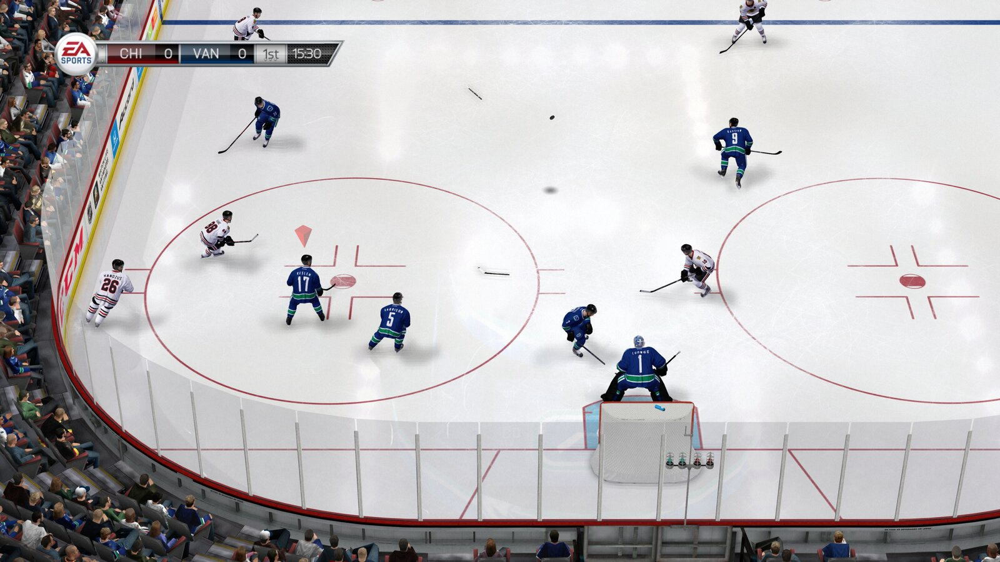
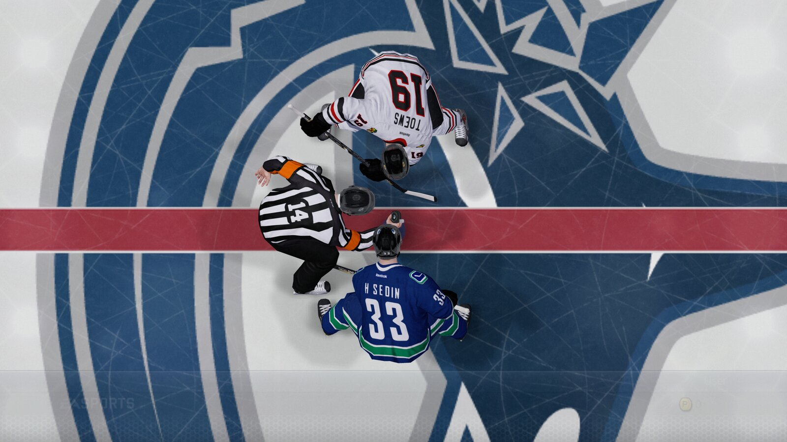
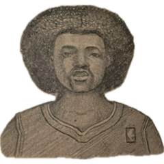

# bardown

**NHL 14 for the Xbox 360, statically recompiled to run as a native program on Linux and Windows.**

[](#linux)
[](#windows)
[](docs/RENDERER.md)
[](#no-game-data-here)

bardown runs NHL 14 as a native program, with no CPU emulation and no GPU emulation:

- **The game itself** (gameplay, AI, physics, menus, everything EA wrote) is the original PowerPC code,
  translated to C++ ahead of time and compiled for x86-64. It's the same game, not a remake.
- **The Xbox's operating system and services** (threads, files, memory, audio, input) are reimplemented
  by the [ReXGlue SDK](https://github.com/rexglue/rexglue-sdk)'s runtime.
- **The graphics are bardown's own.** The game's draw calls are taken over and drawn with Vulkan by a
  renderer written for this game, so the Xbox's GPU isn't emulated either. By default it draws at twice
  the Xbox's resolution.



[Settings](docs/SETTINGS.md) | [The native renderer](docs/RENDERER.md) | [Changelog](CHANGELOG.md)

## Where it is

Every offline mode I've tried plays from start to finish without crashing:

| Mode | Checked |
|---|---|
| Play Now | a full game, opening faceoff to the post-game screen |
| Season | new season, saving, loading, simulating a month, save and exit |
| Be a GM | a new career, the salary cap, simulating preseason |
| Live the Life (Be a Pro) | picking a player, the career hub, shifts with the pro camera, instant replay |
| Be a Legend | Roenick (Lemieux and Gretzky unlock in Be a Pro, as on the Xbox) |
| NHL 94 Anniversary | in play |
| Winter Classic | the flyover and the outdoor rink |
| NHL Moments Live | the 2012-13 moments on the disc |
| Shootout, Playoffs | a shootout; a playoff round simulated |

Those runs were made in 0.1.0, on the emulated GPU. The native renderer has been checked since in the
menus and in full games, but not mode by mode.

Not tried yet: Practice, the Tutorials, Tournament Mode, Battle for the Cup, and a long Be a GM run
through the trade deadline and the draft. Hockey Ultimate Team, online play and the 2013-14 Moments
Live downloads needed EA's servers, which are long gone.

Rough edges I know about:

- a soft "psh" in the audio now and then; not tracked down yet
- the game's own 30 fps cutscenes stay at 30
- the goal netting may look plainer than on the Xbox; not compared yet



## Playing

### What you need

- **Your own copy of NHL 14 for the Xbox 360**, as a disc image (`.iso`) or the folder you extracted the
  disc to. It has to be the base disc with no title update (title ID `454109BE`): the code was recompiled
  from that exact `default.xex`, and any other one is turned away at start rather than crashing later.
  Nothing from the game comes with bardown.
- A 64-bit PC that meets the [system requirements](#system-requirements): Linux or Windows 10/11, and a
  GPU with Vulkan 1.2 on a current driver.

### Linux

1. Download `bardown-<version>-x86_64.AppImage` from the releases and put it in a folder of its own.
2. Put your NHL 14 disc image (`.iso`) in that folder too.
3. Make the AppImage executable: right-click it, Properties, Permissions, "Allow executing file as
   program", or `chmod +x bardown-*.AppImage` in a terminal.
4. Double-click it.

### Windows

1. Download `bardown-<version>-windows-x64.zip` from the releases and unpack it into a folder you can
   write to, such as `C:\Games\bardown` (not Program Files).
2. Put your NHL 14 disc image (`.iso`) in that folder.
3. Double-click `bardown.exe`. Windows SmartScreen may warn about an unknown app, since the program isn't
   code-signed: click "More info", then "Run anyway".

### The first start

The first start takes a few minutes, once: bardown checks the disc is the right version, extracts it into
`game/`, and translates the game's shaders for your GPU. Then the game starts, and from then on it starts
straight away. After that first start the `.iso` isn't needed and can be deleted.

If bardown doesn't find the game beside it, it opens a window asking where it is.

Everything bardown keeps (settings, saves, the shader cache and logs) stays in its own folder, so moving
or deleting the folder moves or deletes all of it. On Windows, if that folder can't be written to, they go
to `%LOCALAPPDATA%\bardown` instead (paste that into File Explorer's address bar to find it).

### Controls

Any controller SDL recognises works: Xbox, PlayStation (DualShock 4, DualSense), Switch Pro and most
others, wired or Bluetooth. Without one, the keyboard stands in for an Xbox pad:

| Pad | Keys |
|---|---|
| Left stick | W A S D (click: F) |
| Right stick | arrow keys (click: K) |
| D-pad | Shift + arrow keys |
| A / B / X / Y | Space or ; / Backspace or ' / L / P |
| Left / right trigger | Q or I / E or O |
| Left / right bumper | 1 / 3 |
| Start / Back | Enter or X / Tab or Z |

Every key can be changed under F1, Keybinds.

### If something goes wrong

- **A message about the disc**: it isn't the base Xbox 360 NHL 14 disc, or it's been patched with a title
  update. Other versions aren't supported.
- **A message about the GPU**: the graphics card or driver is missing a Vulkan feature the renderer needs;
  the message names it. Update the GPU driver first. Setting `native_renderer = false` in `bardown.toml`
  uses the slower emulated GPU instead.
- **The AppImage won't start** on a system without FUSE: run it with `--appimage-extract-and-run`.
- **Anything else**: the `logs` folder beside bardown (or in `%LOCALAPPDATA%\bardown` on Windows) has one
  log per start; the newest one says what happened.

A macOS build isn't available yet.

## System requirements

bardown has been tested on one machine so far. The minimum below comes from what the program needs (the
GPU features its renderer uses, the memory it was measured using), not from running it on weaker
hardware; reports from other systems are welcome.

| | Minimum | Recommended |
|---|---|---|
| OS | 64-bit Linux with glibc 2.35 or newer (Ubuntu 22.04, Mint 21 and later), or Windows 10/11 64-bit | the same |
| CPU | 64-bit x86 with SSE4.2 (Intel 2009+, AMD 2011+), 4 cores | 6 cores or more, from 2015 or later |
| GPU | Vulkan 1.2 with the features below | a desktop GPU from 2016 or later |
| RAM | 8 GB | 16 GB |
| Video memory | 1 GB | 2 GB |
| Disk | 7 GB (the extracted game, plus about 100 MB) | the same, on an SSD |

The GPU needs Vulkan 1.2 with buffer device addresses, descriptor indexing (runtime arrays, partially
bound and variable-count bindings, update-after-bind images, non-uniform indexing), 64-bit shader
integers and dynamic rendering. bardown checks these at startup and says which are missing. Cards that
should have them, though none has been tried: NVIDIA GeForce GTX 900 series and newer, AMD Radeon RX 400
series and newer, Intel UHD 600 and newer, on current drivers. On a GPU without them, the emulated GPU
(`native_renderer = false`) may still work, though it's far heavier.

**Tested on**: Intel Core i9-12900K, NVIDIA GeForce RTX 3090, 32 GB, on Arch Linux and on Windows 11
(the Linux AppImage was also checked to start on Ubuntu 22.04). Measured on Linux: a match at the default
2560x1440 holds 60 fps with the GPU busy 40-50% of the time, using about 2.4 GB of RAM, 0.5 GB of video
memory, and three to four CPU cores' worth of work. At 1280x720 (`native_resolution_scale = 1`) video
memory drops to about 0.2 GB; on a weaker GPU that's the first setting to try. The game keeps about
three and a half cores of that CPU busy, so an older processor may run it but not hold 60; none has
been tried yet.

## Settings

**F1** opens the settings: resolution, audio, controls and key binds, plus a section for NHL 14 itself
with every tuning value the game has, over thirteen thousand of them, from AI and physics to animation.
Changes to those take effect at once and stay saved. More in [docs/SETTINGS.md](docs/SETTINGS.md).

F3 shows frame times, and the backtick key opens a console.

## No game data here

Nothing from NHL 14 is in this repository: no disc image, no `default.xex`, no `.big` archives, no
shaders, and none of the generated C++. Bring your own copy. The code and the shaders are generated
from it on your machine, and the tuning values in the settings are read out of the running game.

## How it's put together

bardown stands on two outside projects and adds its own work on top.

- **[ReXGlue SDK](https://github.com/rexglue/rexglue-sdk)** (BSD 3-Clause), pinned as a submodule. Its
  recompiler turns the game's executable into C++; its runtime provides the Xbox kernel, memory,
  threads, audio, input, the window and the Vulkan device. It also carries a port of Xenia's GPU
  emulator, which bardown keeps only as a fallback.
- **[XenosRecomp](https://github.com/hedge-dev/XenosRecomp)** (MIT), pinned as a submodule, translates
  Xbox shader microcode to HLSL; Microsoft's DirectXShaderCompiler (University of Illinois/NCSA) compiles
  that to SPIR-V. Both ship in the AppImage with their licences.

What bardown adds:

- **The recompilation of NHL 14**: the codegen settings, and 613 function entries the SDK's analysis
  misses (reached only by tail calls or through pointers), found by crash logs and by the scanners in
  `tools/`, each listed in `bardown_functions.toml` with how it was found.
- **The native renderer** (`src/native/`): the game's Direct3D functions are replaced by address. Each
  draw is read from the device's own state and turned into a Vulkan draw; the match's worker-thread
  recordings are put back in GPU order at the swap; textures, resolves and the team-colour composition
  are handled natively. The approach, drawing a recompiled game's Direct3D calls natively, is the one
  Unleashed Recompiled took for Sonic Unleashed; no code was taken from it. Details in
  [docs/RENDERER.md](docs/RENDERER.md).
- **A graphics plugin without GPU emulation** (`rexgpu-native`, in the SDK patch). The game's own
  Direct3D library is still the recompiled original and still writes the Xbox's command stream; the
  plugin answers its fences, interrupts and swaps and draws nothing, while the native renderer draws.
- **Changes to the shader translator** (`sdk/xenosrecomp.patch`) for what this game's shaders need:
  vertex texture fetch, the vertex index, explicit texture LOD, a binary shader cache, and more.
- **Fixes to the SDK** (below), first-run setup that finds and checks the disc, the NHL 14 settings
  section, and the AppImage packaging.

## Building

Needs clang 20 or later, cmake 3.25+, ninja, and the X11 (`x11-xcb`) and Wayland client development
headers. The Vulkan headers come with the SDK.

```sh
git clone --recursive https://github.com/griby-man/bardown.git
cd bardown

# the sdk, once
cd third_party/rexglue-sdk
git apply ../../sdk/bardown-sdk.patch
cmake --preset linux-amd64
cmake --build out/build/linux-amd64 --config Release --target install
cd ../..

# the shader translator, once
git -C third_party/XenosRecomp apply ../../sdk/xenosrecomp.patch
cmake -S third_party/XenosRecomp -B out/build/xenosrecomp -G Ninja -DCMAKE_BUILD_TYPE=Release \
  -DCMAKE_C_COMPILER=clang -DCMAKE_CXX_COMPILER=clang++
cmake --build out/build/xenosrecomp

# your extracted disc goes in dumps/game (default.xex and the .big archives)

third_party/rexglue-sdk/out/install/linux-amd64/bin/rexglue codegen bardown_manifest.toml
cmake --preset linux-amd64-release
cmake --build out/build/linux-amd64-release -j16

scripts/run.sh
```

Codegen takes about a quarter of an hour, and the build longer. The shaders are translated on the first
start.

### Release builds

Both reuse `generated/` from the build above, so codegen runs once.

- **Linux, for older distros**: built inside an Ubuntu 22.04 container so the AppImage needs nothing newer
  than glibc 2.35; it carries a newer C++ runtime and uses it only where the system's is older.

  ```sh
  podman build -t bardown-build -f packaging/Containerfile packaging
  podman run --rm -v "$PWD":/src:Z -w /src bardown-build scripts/build-compat.sh
  BARDOWN_BUILD=out/build/linux-compat BARDOWN_XENOSRECOMP=out/build/xenosrecomp-compat scripts/appimage.sh <version>
  ```

- **Windows**, cross-compiled from Linux with clang against Microsoft's C runtime and Windows SDK, unpacked
  by [xwin](https://github.com/Jake-Shadle/xwin) (`xwin --accept-license splat --output ~/.xwin`). The SDK,
  the shader translator and bardown each get configured with `-DCMAKE_TOOLCHAIN_FILE=cmake/windows-xwin.cmake`
  (the SDK also with `-DREXGLUE_USE_D3D12=OFF`, and bardown with `-Drexglue_DIR` pointing at that SDK
  install); `scripts/windows-zip.sh` then packs the zip, taking Microsoft's C++ runtime DLLs out of their
  redistributable installer (`VC_REDIST=vc_redist.x64.exe`).

## What's where

- `bardown_manifest.toml`, `bardown_functions.toml`: codegen settings, and the functions the scanner
  can't find on its own
- `src/`: bardown's own code: setup, the settings, scripted input, capture probes
- `src/native/`: the native renderer
- `sdk/`: bardown's changes to the pinned SDK and shader translator
- `scripts/run.sh`: the development launcher. `scripts/run.sh harvest` logs missing call targets
  instead of stopping at the first one
- `scripts/appimage.sh`, `scripts/build-compat.sh`, `scripts/windows-zip.sh`, `cmake/windows-xwin.cmake`:
  the release builds
- `tools/`: the code scanners and development tools

## Fixes to the SDK

Kept in `sdk/bardown-sdk.patch`:

- **VP6 video**: the vector pack instructions wrote their result while it still overlapped the inputs.
  Videos came out as green blocks.
- **Input**: device refresh ran unlocked from several game threads and corrupted the heap a few seconds
  in.
- **Guest memory**: unlinked as soon as it's created, so a hard exit no longer leaves 4.8 GB in RAM.
- **Settings window**: sized in units of the font, so it opens at a readable size on a 4K screen instead of
  620 pixels wide with the categories cut off.
- **RenderDoc**: only attached when it's already injected.
- **For the native renderer**: the Vulkan device features it needs, a way for the program to own the
  window's picture, and the `rexgpu-native` plugin.
- **For the emulated GPU** (the fallback):
  - lighting: the Vulkan shader translator read a texture's exponent bias from the wrong word, and lit
    textures came out two to four times too bright;
  - equipment colours: render targets the game reads back are resolved once when they're built, and a
    frame late when they repeat; a target redrawn every frame for half a second isn't copied back at
    all, since the game never reads those and copying them moved 1.8 GB a second;
  - a warning about invalid texture constants is reported once instead of for every draw, which had
    reached 1,800 lines a second and showed up as hitches.
- Debug switches, all off unless asked for: `REX_HARVEST_UNREGISTERED`, `REX_ABORT_ON_GUEST_AV`,
  `REX_LOG_FPS`, `REX_LOG_RT_FORMATS`, `--gpu_wait_spin`.

## Spice



Spice Adams, bardown's mascot, endorses this game.

> "Wrong game, Spice."
>
> "Not now, chief. I'm in the zone."

## Licence

bardown's own code is released under the [GNU General Public License v3.0](LICENSE). The parts it builds on keep
their own licences: the ReXGlue SDK (BSD 3-Clause), XenosRecomp (MIT) and DirectXShaderCompiler (University of
Illinois/NCSA), with copies in `packaging/licenses` and in every release build. NHL 14 itself belongs to
Electronic Arts and isn't covered by any of them.

Contributions are welcome; [CONTRIBUTING.md](CONTRIBUTING.md) has how.

## Legal

Unofficial. Not affiliated with or endorsed by Electronic Arts, the NHL or Microsoft.
